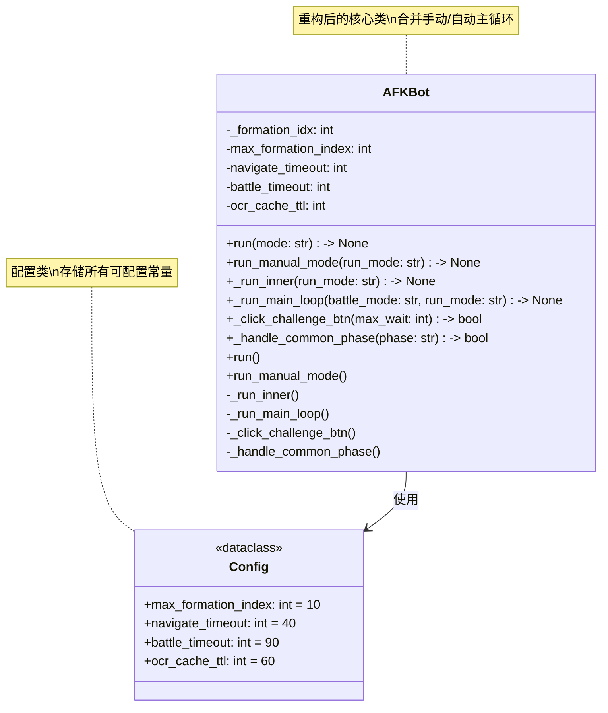
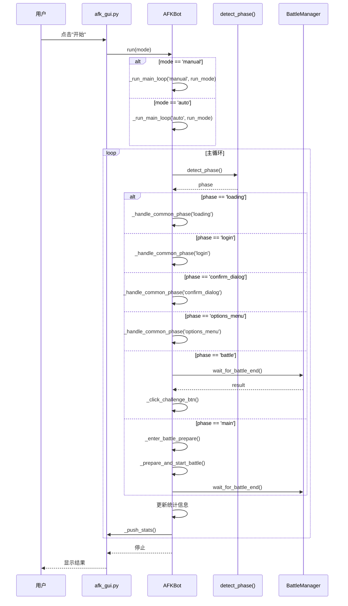
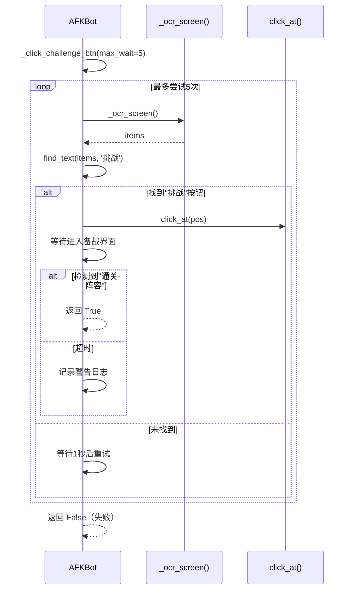

# P1 重构方案：AFK Journey 自动化工具代码质量提升

**版本**: v1.0  
**日期**: 2025-03-20  
**架构师**: 高见远  
**参考文档**: ARCHITECTURE_REVIEW.md  

---

## 1. 实现方案 + 框架选型

### 1.1 核心技术方案

本次重构**不引入新的设计模式或框架**，采用**渐进式重构**策略：

| 重构项 | 技术方案 | 理由 |
|--------|----------|------|
| 任务4：合并主循环 | **提取公共方法** `_run_main_loop(battle_mode)` | 两个方法逻辑相似度>80%，适合提取参数化公共方法 |
| 任务5：消除重复代码 | **提取工具方法** `_click_challenge_btn()` + `_handle_common_phase()` | 简单直接，不改变架构 |
| 任务6：硬编码常量配置化 | **配置类属性** + **JSON 配置文件** | 与现有配置系统对齐，不引入新依赖 |

### 1.2 设计模式考量

**不采用策略模式的原因**：
- 手动/自动模式差异不够大（仅战斗结束处理逻辑不同）
- 策略模式会增加代码复杂度，违背"简单可用"原则

**不采用模板方法模式的原因**：
- Python 是动态语言，直接用条件分支 + 参数化更简单
- 模板方法适合静态语言（如Java/C++），Python 用鸭子类型更灵活

### 1.3 技术债务处理

重构过程中发现的技术债务：
1. **`_run_inner()` 方法过长**（~580行）→ 本次重构先合并，后续拆分（P2任务）
2. **`detect_phase()` 返回值处理不完整** → 已纳入任务4统一处理

---

## 2. 文件列表及相对路径

| 文件路径 | 操作 | 说明 |
|----------|------|------|
| `afk_bot.py` | **修改** | 核心重构文件，涉及任务4/5/6 |
| `afk_gui.py` | **修改** | 添加配置项到GUI（任务6） |
| `P1_REFACTOR_TEST.md` | **新增** | 重构验证测试用例 |
| `docs/refactor_diff.md` | **新增** | 重构前后代码对比（可选） |

**总计文件数**: 4个（2个修改 + 2个新增）

---

## 3. 数据结构和接口（类图）



**关键接口变更**：

| 方法名 | 变更类型 | 说明 |
|--------|----------|------|
| `_run_main_loop(self, battle_mode, run_mode)` | **新增** | 合并后的主循环，替代 `run_manual_mode()` 和 `_run_inner()` |
| `_click_challenge_btn(self, max_wait=5)` | **新增** | 合并 `_click_challenge_after_victory()` 和 `_click_retry_after_defeat()` |
| `_handle_common_phase(self, phase)` | **新增** | 提取公共 phase 处理逻辑 |
| `run_manual_mode()` | **删除** | 合并到 `_run_main_loop()` |
| `_run_inner()` | **删除** | 合并到 `_run_main_loop()` |

---

## 4. 程序调用流程（时序图）

### 4.1 重构后的主循环流程



### 4.2 `_click_challenge_btn()` 方法流程



---

## 5. 任务列表（有序、含依赖关系）

### 5.1 任务概览

| 任务ID | 任务名称 | 涉及文件 | 预估工作量 | 依赖 | 优先级 |
|--------|----------|----------|------------|------|--------|
| **T01** | 提取硬编码常量为配置项 | `afk_bot.py`, `afk_gui.py` | 1-2小时 | 无 | P0 |
| **T02** | 提取 `_click_challenge_btn()` 方法 | `afk_bot.py` | 2-3小时 | T01 | P1 |
| **T03** | 提取 `_handle_common_phase()` 方法 | `afk_bot.py` | 2-3小时 | T01 | P1 |
| **T04** | 合并主循环为 `_run_main_loop()` | `afk_bot.py` | 4-6小时 | T02, T03 | P1 |
| **T05** | 编写重构验证测试 | `P1_REFACTOR_TEST.md` | 1-2小时 | T04 | P2 |

### 5.2 详细任务分解

#### **T01: 提取硬编码常量为配置项**

**目标**: 将所有硬编码常量提取为配置项，提高可配置性

**步骤**:
1. 在 `AFKBot.__init__()` 中添加配置属性：
   ```python
   # 配置项（可从配置文件覆盖）
   self.max_formation_index = config.get('max_formation_index', 10)
   self.navigate_timeout = config.get('navigate_timeout', 40)
   self.battle_timeout = config.get('battle_timeout', 90)
   self.ocr_cache_ttl = config.get('ocr_cache_ttl', 60)
   ```

2. 替换 `afk_bot.py` 中的硬编码值：
   - 第2907行：`if self._formation_idx >= 10:` → `>= self.max_formation_index`
   - 第3538行：`if fidx >= 5:` → `>= self.max_formation_index`
   - 第1714行：`timeout=40` → `timeout=self.navigate_timeout`
   - 第1866行：`timeout=90` → `timeout=self.battle_timeout`
   - 第1160行：`ttl=60` → `ttl=self.ocr_cache_ttl`

3. 在 `afk_gui.py` 中添加配置加载/保存逻辑：
   ```python
   # 默认值
   DEFAULT_CONFIG = {
       'max_formation_index': 10,
       'navigate_timeout': 40,
       'battle_timeout': 90,
       'ocr_cache_ttl': 60,
   }
   ```

**验证**:
- 运行原有功能，确认常量替换后行为一致
- 修改配置文件中的值，确认生效

---

#### **T02: 提取 `_click_challenge_btn()` 方法**

**目标**: 合并 `_click_challenge_after_victory()` 和 `_click_retry_after_defeat()` 为公共方法

**步骤**:
1. 创建新方法 `_click_challenge_btn(self, max_wait=5)`:
   ```python
   def _click_challenge_btn(self, max_wait=5):
       """点击'挑战'按钮，等待进入备战界面（合并胜利/失败后的逻辑）"""
       self.log('[信息] 点击挑战按钮')
       
       for attempt in range(max_wait):
           if self._stop:
               return False
           
           items = self._ocr_screen()
           pos = self.find_text(items, '挑战')
           
           if pos:
               self.click_at(pos[0], pos[1], '挑战')
               # 等待进入备战界面
               for wait in range(20):
                   if self._stop:
                       return False
                   self._stop_event.wait(0.5)
                   items2 = self._ocr_screen()
                   if any('通关阵容' in t for t in [t2 for _, _, t2, c, *_ in items2 if c >= 0.5]):
                       self.log('[成功] 已进入备战界面')
                       return True
               self.log('[警告] 等待备战界面超时')
               return False
           else:
               self.log(f'[警告] 未找到挑战按钮，重试 #{attempt}')
               self._stop_event.wait(1)
       
       self.log('[错误] 未找到挑战按钮')
       return False
   ```

2. 更新调用方：
   - `run_manual_mode()` 第2928行：`self._click_challenge_after_victory(current_mode)` → `self._click_challenge_btn()`
   - `run_manual_mode()` 第3038行：`self._click_retry_after_defeat()` → `self._click_challenge_btn()`

3. 删除旧方法：
   - 删除 `_click_challenge_after_victory()` (第2929-2964行)
   - 删除 `_click_retry_after_defeat()` (第2966-3000行)

**验证**:
- 手动模式下胜利后是否能正确点击"挑战"
- 手动模式下失败后能否正确点击"挑战"

---

#### **T03: 提取 `_handle_common_phase()` 方法**

**目标**: 提取主循环中重复出现的 phase 处理逻辑

**步骤**:
1. 创建新方法 `_handle_common_phase(self, phase)`:
   ```python
   def _handle_common_phase(self, phase):
       """处理常见的 phase（loading/login/confirm_dialog/options_menu）
       返回 True 表示已处理，返回 False 表示需要调用方进一步处理
       """
       if phase == 'loading':
           self.log('[信息] 等待加载完成')
           while phase == 'loading' and not self._stop:
               self._stop_event.wait(5)
               phase = self.detect_phase()
           return True
       
       elif phase == 'login':
           self.log('[信息] 点击开始游戏')
           self._handle_login()
           return True
       
       elif phase == 'confirm_dialog':
           self.log('[信息] 取消退出弹窗')
           self._close_exit_dialog()
           return True
       
       elif phase == 'options_menu':
           self.log('[信息] 关闭菜单')
           self._send_esc()
           self._stop_event.wait(1)
           return True
       
       return False
   ```

2. 在 `_run_inner()` 中调用新方法（3处）：
   - 第3462-3478行 → `if self._handle_common_phase(phase): continue`
   - 第3529-3551行 → `if self._handle_common_phase(phase): continue`
   - 第3653-3676行 → `if self._handle_common_phase(phase): continue`

**验证**:
- 自动模式下遇到 loading/login/confirm_dialog/options_menu 时能正确处理
- 手动模式下（暂时）不调用此方法，待任务4合并后统一处理

---

#### **T04: 合并主循环为 `_run_main_loop()`**

**目标**: 合并 `run_manual_mode()` 和 `_run_inner()` 为一个方法

**步骤**:
1. 创建新方法 `_run_main_loop(self, battle_mode, run_mode)`:
   - `battle_mode`: `'manual'` 或 `'auto'`，区分手动/自动模式
   - `run_mode`: `'normal'` / `'huanling'` / `'alternate'`，区分挑战类型

2. 合并逻辑：
   - **公共部分**（两个方法都有的）：
     - 检测 phase
     - 处理常见 phase (loading/login/confirm_dialog/options_menu)
     - 更新统计信息
     - 切换阵容
   
   - **差异部分**（通过条件分支处理）：
     - 手动模式：等待用户点击"下一场"
     - 自动模式：自动点击"挑战"按钮

3. 更新 `run()` 方法调用：
   ```python
   if mode == 'manual':
       self._run_main_loop('manual', run_mode)
   else:
       self._run_main_loop('auto', run_mode)
   ```

4. 删除旧方法：
   - 删除 `run_manual_mode()` (第2700-2861行)
   - 删除 `_run_inner()` (第3407-3774行)

**验证**:
- 手动模式下完整流程测试（胜利/失败/切换阵容）
- 自动模式下完整流程测试（normal/huanling/alternate）
- 边界情况测试（loading/login/confirm_dialog 等）

---

#### **T05: 编写重构验证测试**

**目标**: 确保重构后功能不回归

**测试清单**:
1. **单元测试**（如果有 pytest）：
   - `_click_challenge_btn()` 正常流程
   - `_click_challenge_btn()` 超时流程
   - `_handle_common_phase()` 各分支

2. **集成测试**（手动测试）：
   - 手动模式：胜利后继续、失败后切换阵容、10套阵容遍历
   - 自动模式：normal/huanling/alternate 三种模式
   - 边界情况：loading 界面、login 界面、确认弹窗

3. **回归测试**：
   - 对比重构前后的日志输出，确认一致性
   - 对比重构前后的战斗统计，确认一致性

**输出**: `P1_REFACTOR_TEST.md` 测试报告

---

## 6. 依赖包列表

**本次重构不引入新的依赖包**。

现有依赖包（已在项目中使用）：
```
pyautogui          # 鼠标键盘控制
Pillow             # 截图
opencv-python      # 模板匹配
numpy              # 数组处理
customtkinter      # GUI
pyocr              # OCR
```

---

## 7. 共享知识（跨文件约定）

重构后，团队成员需要了解以下约定：

### 7.1 配置项命名规范

| 配置项 | 类型 | 默认值 | 说明 |
|--------|------|--------|------|
| `max_formation_index` | int | 10 | 最大阵容索引（0-9） |
| `navigate_timeout` | int | 40 | 导航超时（秒） |
| `battle_timeout` | int | 90 | 战斗超时（秒） |
| `ocr_cache_ttl` | int | 60 | OCR缓存有效期（秒） |

**约定**:
- 配置项名称使用 **snake_case**
- 配置项必须在 `DEFAULT_CONFIG` 中定义默认值
- 配置项必须在 `AFKBot.__init__()` 中初始化

### 7.2 方法命名规范

| 方法名 | 可见性 | 说明 |
|--------|--------|------|
| `_run_main_loop()` | private | 主循环（合并后） |
| `_click_challenge_btn()` | private | 点击"挑战"按钮 |
| `_handle_common_phase()` | private | 处理常见 phase |

**约定**:
- 私有方法使用 **前缀下划线**
- 方法名使用 **snake_case**
- 方法名必须 **动词开头**（`run_`, `click_`, `handle_`）

### 7.3 Phase 处理顺序

在主循环中，phase 的处理顺序必须为：
1. `loading` → 等待加载完成
2. `login` → 点击开始游戏
3. `confirm_dialog` → 关闭退出弹窗
4. `options_menu` → ESC关闭菜单
5. `battle` → 等待战斗结束
6. `result` → 关闭结算界面
7. `main` / `formation` → 进入备战/开始战斗

**约定**:
- 新增 phase 类型时，必须在 `_handle_common_phase()` 中添加处理逻辑
- phase 处理必须考虑 `self._stop` 标志（优雅停止）

---

## 8. 待明确事项

### 8.1 需要团队确认的问题

| 问题 | 当前状态 | 需要确认 |
|------|----------|----------|
| **手动模式和自动模式的差异** | 仅战斗结束处理逻辑不同 | 是否还有其他差异？ |
| **`formation_idx` 最大值** | 当前手动=10，自动=5（已修复为10） | 是否应该让用户可配置？ |
| **OCR缓存时间** | 当前硬编码60秒 | 是否应该根据战斗类型动态调整？ |

### 8.2 重构风险评估

| 风险 | 影响 | 缓解措施 |
|------|------|----------|
| **合并主循环引入回归Bug** | 高 | 详细对比两个方法的差异 + 全面测试 |
| **提取方法后性能下降** | 低 | 方法调用开销可忽略 + 性能测试 |
| **配置文件格式不兼容** | 中 | 提供迁移脚本 + 备份原有配置 |

### 8.3 后续优化建议（P2任务）

1. **拆分 `_run_main_loop()` 方法**（当前~200行）
   - 提取 `_handle_battle_phase()`
   - 提取 `_handle_result_phase()`
   - 提取 `_update_statistics()`

2. **添加单元测试**
   - 使用 `pytest` 框架
   - 模拟 `detect_phase()` 返回值
   - 模拟 `_ocr_screen()` 返回值

3. **添加类型注解**
   - 为所有公共方法添加类型注解
   - 使用 `mypy` 进行静态类型检查

---

## 9. 实施时间表

| 阶段 | 任务 | 预估时间 | 负责人 | 输出 |
|------|------|----------|--------|------|
| **第1天** | T01: 提取配置项 | 1-2小时 | 待定 | 配置化代码 |
| **第2天** | T02: 提取 `_click_challenge_btn()` | 2-3小时 | 待定 | 消除重复代码 |
| **第3天** | T03: 提取 `_handle_common_phase()` | 2-3小时 | 待定 | 消除重复代码 |
| **第4-5天** | T04: 合并主循环 | 4-6小时 | 待定 | 合并后的主循环 |
| **第6天** | T05: 编写测试 + 回归测试 | 1-2小时 | 待定 | 测试报告 |

**总计工作量**: 10-16小时（约2-3个工作日）

---

## 10. 附录：重构前后代码对比

### 10.1 重构前（存在问题）

```python
# 问题1：两个方法逻辑重复
def run_manual_mode(self, run_mode):
    # ... 检测phase ...
    # ... 处理phase ...
    # ... 更新统计 ...
    # ... 切换阵容 ...

def _run_inner(self, run_mode):
    # ... 检测phase ...
    # ... 处理phase ...
    # ... 更新统计 ...
    # ... 切换阵容 ...

# 问题2：重复代码
def _click_challenge_after_victory(self, current_mode):
    # ... 等待按钮出现 ...
    # ... 点击按钮 ...
    # ... 等待进入备战界面 ...

def _click_retry_after_defeat(self):
    # ... 等待按钮出现 ...
    # ... 点击按钮 ...
    # ... 等待进入备战界面 ...

# 问题3：硬编码常量
if self._formation_idx >= 10:  # 硬编码
    pass
timeout = 40  # 硬编码
```

### 10.2 重构后（解决问题）

```python
# 解决1：合并为一个方法
def _run_main_loop(self, battle_mode, run_mode):
    # ... 检测phase ...
    # ... 处理phase（调用_handle_common_phase）...
    # ... 更新统计 ...
    # ... 切换阵容 ...
    # ... 根据battle_mode区分行为 ...

# 解决2：提取公共方法
def _click_challenge_btn(self, max_wait=5):
    # ... 等待按钮出现 ...
    # ... 点击按钮 ...
    # ... 等待进入备战界面 ...

def _handle_common_phase(self, phase):
    # ... 处理loading/login/confirm_dialog/options_menu ...

# 解决3：配置化
if self._formation_idx >= self.max_formation_index:
    pass
timeout = self.navigate_timeout
```

---

## 11. 结论

本次 P1 重构将解决代码重复、硬编码常量、可维护性差等问题。通过合并主循环、提取公共方法、配置化常量，可以显著提高代码质量，降低Bug风险，并为后续优化（P2任务）打下基础。

**关键成功因素**：
1. 详细对比 `run_manual_mode()` 和 `_run_inner()` 的差异
2. 全面测试手动/自动模式的各种场景
3. 与团队确认配置项的设计（是否允许用户自定义）

**下一步**：
1. 团队评审本重构方案
2. 确认实施优先级和时间表
3. 开始实施 T01 任务（提取配置项）
